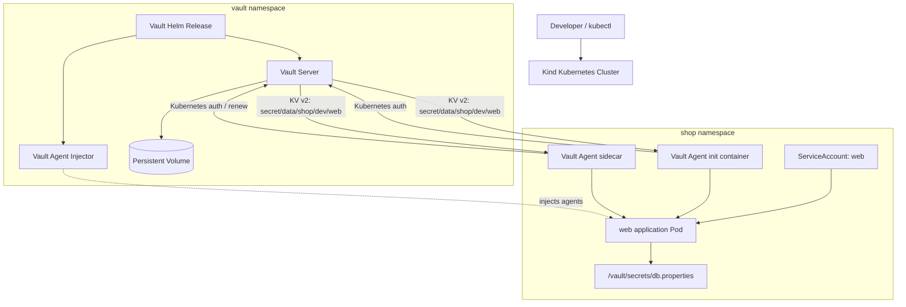

# HashiCorp Vault on Kubernetes (Kind) — Secrets Management Lab

A hands-on DevOps lab demonstrating how to run HashiCorp Vault in a local Kind Kubernetes cluster and securely deliver application secrets using Kubernetes authentication and the Vault Agent Injector.

> **Scope:** Local learning/testing environment on bare-metal Linux with Kind. This is not a production Vault deployment.

## Architecture



## What this lab covers

- Install Vault with Helm in standalone mode.
- Persist Vault data using a Kubernetes PVC.
- Initialize and unseal Vault for a local lab.
- Enable KV v2 and create a test secret.
- Enable Kubernetes authentication.
- Create a least-privilege policy for one secret path.
- Bind a Kubernetes ServiceAccount to a Vault role.
- Inject secrets into a pod using Vault Agent Injector.
- Verify the injected file and troubleshoot common `403 permission denied` errors.

## Prerequisites

- Linux host with `kubectl`, `kind`, `helm`, `docker` and `jq`.
- A working Kind cluster.
- Internet access to pull container images and the local-path provisioner manifest.
- A `local-path` StorageClass. The install script can install Rancher's local-path provisioner if it is missing.

Check tools:

```bash
kind version
kubectl version --client
helm version
docker version
jq --version
```

## Repository layout

```text
vault-kind-lab/
├── README.md
├── LICENSE
├── .gitignore
├── .editorconfig
├── vault/
│   └── values.yaml
├── policies/
│   └── shop-dev-policy.hcl
├── kubernetes/
│   ├── namespaces.yaml
│   ├── web-serviceaccount.yaml
│   └── web-deployment.yaml
└── scripts/
    ├── install-vault.sh
    ├── initialize-vault.sh
    ├── deploy-demo-app.sh
    └── verify-vault.sh
```

## 1. Clone and prepare

```bash
git clone https://github.com/<YOUR_GITHUB_USERNAME>/vault-kind-lab.git
cd vault-kind-lab
chmod +x scripts/*.sh
```

Create or select your Kind cluster:

```bash
kind create cluster --name vault-lab
kubectl cluster-info --context kind-vault-lab
```

If you already have a Kind cluster, select its context instead.

## 2. Install Vault

```bash
./scripts/install-vault.sh
```

The script:
1. Checks the required CLI tools.
2. Installs the `local-path` StorageClass provisioner if needed.
3. Adds the HashiCorp Helm repository.
4. Installs Vault in the `vault` namespace.
5. Waits for the Vault server pod.

Vault runs with TLS disabled in this isolated local lab. Do not expose this service outside the local cluster.

## 3. Initialize and configure Vault

```bash
./scripts/initialize-vault.sh
```

The script initializes Vault if it is not already initialized, unseals it, enables KV v2, writes a dummy development secret, installs the read-only policy, enables Kubernetes auth, configures the Kubernetes auth backend and creates the `web-dev` role.

**Sensitive local state:** initialization output is saved under `.vault-local/` with restrictive file permissions. This directory is ignored by Git. Back up unseal keys and root tokens securely for a real environment; never commit them.

The demo secret contains only placeholders:
- `api_key`: `REPLACE_WITH_TEST_VALUE`
- `db_user`: `webuser`
- `db_password`: `REPLACE_WITH_TEST_VALUE`

Replace these only with disposable lab values. Never use production credentials.

## 4. Deploy the demo application

```bash
./scripts/deploy-demo-app.sh
```

The deployment uses the `web` ServiceAccount in the `shop` namespace. Vault Agent Injector authenticates with the `web-dev` Vault role and renders the KV v2 secret into:

```text
/vault/secrets/db.properties
```

The demo container is intentionally minimal and sleeps so you can inspect the injected file.

## 5. Verify the integration

```bash
./scripts/verify-vault.sh
```

You can also inspect the pod and injection status:

```bash
kubectl get pods -n vault
kubectl get pods -n shop
kubectl describe pod -n shop -l app=web
kubectl logs -n shop deployment/web -c vault-agent
```

Check the injected file without printing credentials:

```bash
kubectl exec -n shop deployment/web -c web -- \
  sh -c 'test -s /vault/secrets/db.properties && echo "Secret file exists"'
```

To inspect the file during a disposable lab session:

```bash
kubectl exec -n shop deployment/web -c web -- \
  cat /vault/secrets/db.properties
```

Do not paste real secret values into tickets, public logs or screenshots.

## Important KV v2 policy detail

For a KV v2 mount named `secret/`, the API data path includes `/data/`. The policy must therefore authorize:

```hcl
path "secret/data/shop/dev/web" {
  capabilities = ["read"]
}
```

The CLI path is different:

```bash
vault kv get -mount=secret shop/dev/web
```

A common cause of HTTP 403 is granting the policy to one token while the Vault Agent authenticates with a different Kubernetes role/token. Verify the role and the Agent's actual identity, not only the administrator token.

## Troubleshooting

### Vault Agent returns 403

1. Confirm the secret exists:

   ```bash
   kubectl exec -n vault vault-0 -- vault kv get -mount=secret shop/dev/web
   ```

2. Inspect the policy:

   ```bash
   kubectl exec -n vault vault-0 -- vault policy read shop-dev-policy
   ```

3. Inspect the Kubernetes role:

   ```bash
   kubectl exec -n vault vault-0 -- vault read auth/kubernetes/role/web-dev
   ```

4. Confirm the role binds `web` in namespace `shop` and includes `shop-dev-policy`.
5. Check Vault Agent logs:

   ```bash
   kubectl logs -n shop deployment/web -c vault-agent --tail=100
   ```

6. Remember: `vault token capabilities ...` run with a root/admin token only verifies that token. It does not verify the Agent token.

### PVC remains Pending

```bash
kubectl get storageclass
kubectl get pvc -n vault
kubectl describe pvc -n vault
```

Confirm a default StorageClass or `local-path` exists and its provisioner pod is healthy.

### Injector does not mutate the pod

```bash
kubectl get pods -n vault
kubectl logs -n vault deployment/vault-agent-injector
kubectl describe pod -n shop -l app=web
```

Check that the injector is enabled, the annotations are on the pod template, and the Vault role matches the ServiceAccount and namespace.

## Cleanup

Delete the demo application and Vault release:

```bash
kubectl delete namespace shop
helm uninstall vault -n vault
kubectl delete namespace vault
```

Delete the Kind cluster when you no longer need it:

```bash
kind delete cluster --name vault-lab
```

The local `.vault-local/` directory contains sensitive lab initialization material. Delete it securely when the lab is no longer needed.

## Security limitations

This repository intentionally uses a simplified local lab:
- Vault listener TLS is disabled.
- A single Vault server is used; no HA or disaster recovery.
- Unseal material is stored locally for the disposable lab workflow.
- Demo credentials are placeholders only.
- The example application is not a production application.

For production, use TLS, HA storage, hardened authentication, external secret lifecycle management, audit devices, backups, restricted network policies, least-privilege policies, and a secure unseal/auto-unseal strategy.

## Learning outcomes

After completing this lab, you should be able to explain the Vault Agent Injector flow, Kubernetes auth role binding, KV v2 API paths, Vault policy capabilities, and how to troubleshoot authentication and authorization failures.

## Author

Created as a personal DevOps learning and portfolio project.
